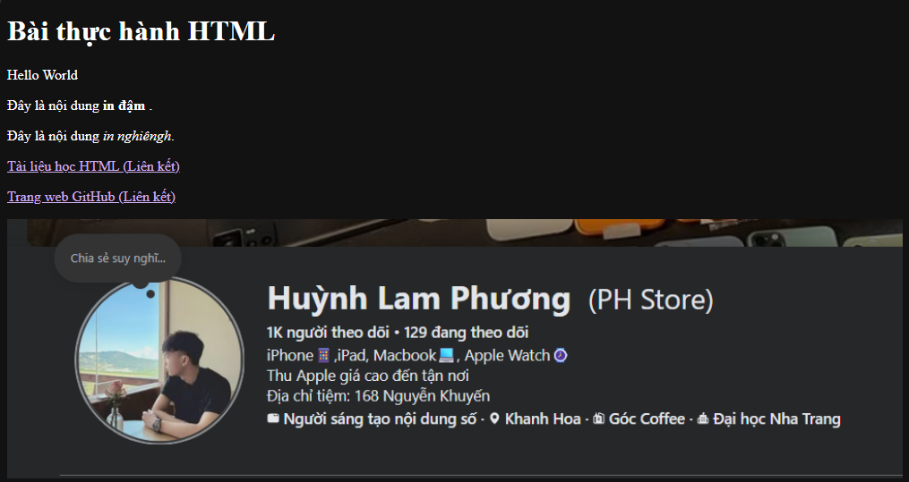

# 02. HTML cơ bản

## 1. Mục tiêu

- Hiểu khái niệm và vai trò của HTML.
- Nắm được cấu trúc tài liệu HTML.
- Biết sử dụng các thẻ và thuộc tính cơ bản.
- Xây dựng và chạy thử trang web đơn giản.

## 2. Tài liệu tham khảo

[Basic HTML Syntax - MDN](https://developer.mozilla.org/en-US/docs/Learn_web_development/Core/Structuring_content/Basic_HTML_syntax)

## 3. Kiến thức lý thuyết

### 3.1. Khái niệm HTML

HTML (HyperText Markup Language) là ngôn ngữ đánh dấu
siêu văn bản, được sử dụng để xây dựng cấu trúc
và nội dung của trang web.

### 3.2. Cấu tạo phần tử HTML

Một phần tử HTML thông thường bao gồm:

- Thẻ mở.
- Nội dung.
- Thẻ đóng.

Ví dụ:

```html
<p>Xin chào HTML</p>
```

### 3.3. Các thẻ HTML cơ bản

| Thẻ | Chức năng |
| --- | --- |
| html | Phần tử gốc của tài liệu |
| head | Chứa thông tin tài liệu |
| body | Chứa nội dung trang web |
| title | Tiêu đề trang web |
| h1 | Tiêu đề chính |
| p | Đoạn văn bản |
| strong | Nội dung quan trọng |
| em | Nội dung nhấn mạnh |
| a | Tạo liên kết |
| img | Hiển thị hình ảnh |

### 3.4. Thuộc tính HTML

Thuộc tính cung cấp thông tin bổ sung cho phần tử.

- href: Địa chỉ liên kết.
- src: Đường dẫn hình ảnh.
- alt: Văn bản thay thế hình ảnh.
- width: Chiều rộng hình ảnh.
- lang: Ngôn ngữ của tài liệu.

### 3.5. Cấu trúc tài liệu HTML

```html
<!DOCTYPE html>
<html lang="vi">
<head>
    <meta charset="UTF-8">
    <title>Trang web đầu tiên</title>
</head>
<body>
    <h1>Xin chào HTML</h1>
    <p>Nội dung trang web.</p>
</body>
</html>
```

### 3.6. Khoảng trắng trong HTML

Trình duyệt thường gộp nhiều khoảng trắng liên tiếp
thành một khoảng trắng khi hiển thị văn bản.

### 3.7. Ký tự đặc biệt

| Ký tự | Mã HTML |
| --- | --- |
| Dấu nhỏ hơn | `&lt;` |
| Dấu lớn hơn | `&gt;` |
| Dấu và | `&amp;` |
| Dấu ngoặc kép | `&quot;` |

### 3.8. Chú thích HTML

Chú thích được sử dụng để giải thích mã nguồn
và không hiển thị trên trang web.

```html
<!-- Đây là chú thích HTML -->
```

## 4. Nội dung thực hành

- Tạo file index.html bằng Visual Studio Code.
- Sử dụng các thẻ HTML cơ bản.
- Tạo liên kết đến MDN và GitHub.
- Hiển thị hình ảnh Firefox.
- Chạy trang web bằng Live Server.

## 5. Kết quả thực hành

- Trang web hiển thị thành công.
- Tiêu đề và văn bản hiển thị đúng.
- Các liên kết và hình ảnh được hiển thị.
- Hiểu được cách xây dựng trang HTML cơ bản.

## 6. Hình ảnh minh chứng



